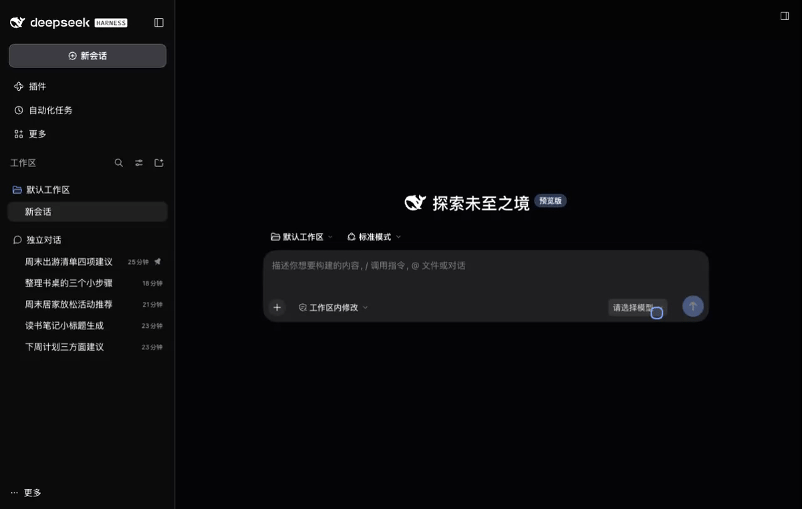
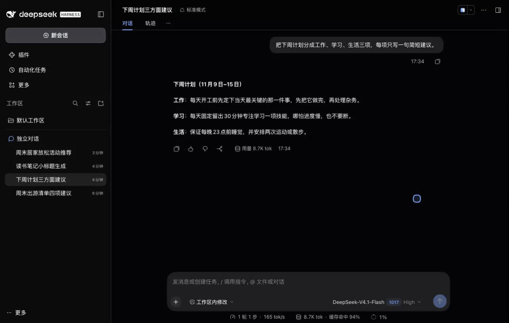
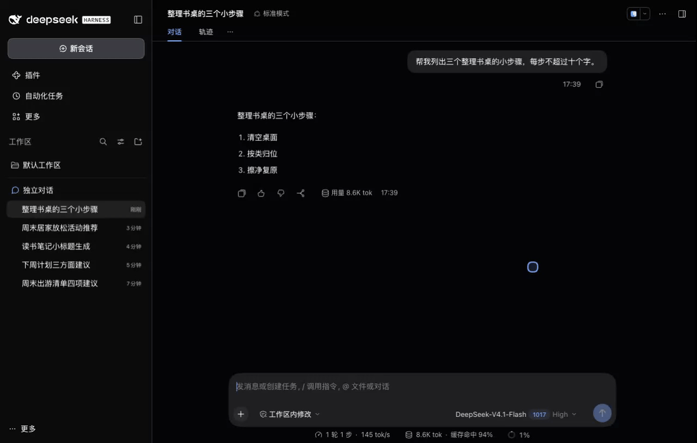
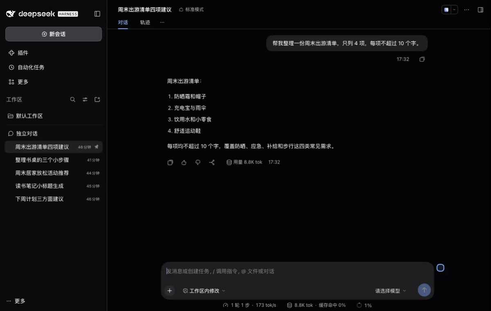

  

<h1 align="center">dsh-chat-sessions</h1>

  <a href="README.md">简体中文</a> · English

  
  
  

  <a href="#features">Features</a> · <a href="#installation">Installation</a> · <a href="#notes">Notes</a> · <a href="docs/CONFIGURATION.en.md">Configuration</a> · <a href="CHANGELOG.md">Changelog</a>

---

A [DeepSeek Harness](https://github.com/deepseek-ai/deepseek-harness) plugin that creates a chat with its own workspace in one click, so everyday questions and small tasks can start without manually choosing a project directory.

  

## Features

| Feature | Description |
| --- | --- |
| **One click, a workspace of its own** | New chats get their own workspace; chats derived from them may continue using the same directory. |
| **Familiar session controls** | Interactions follow native DSH. Switch, pin, archive, and restore chats the way you already know, with no new workflow to learn. |
| **Files that are easy to find** | File shortcuts are organized by chat title, making it easy to find the files created in a conversation and open, edit, or reuse them later. |

### Feature demos

Start in one click

  

Session management

  

Archive and restore

  

## Requirements

Requires DeepSeek Harness `>=0.2.0-rc.2 <0.3.0-0`; developed and tested against `0.2.2-rc.1`.

## Installation

Current version: **v0.2.0**, available from [GitHub Release](https://github.com/ZSQBFan/dsh-chat-sessions/releases/tag/v0.2.0).

1. Download `dsh-chat-sessions-0.2.0.tgz` from the Release (a SHA256 checksum file is included separately).
2. In DSH's plugin page, choose “Add plugin”, enter the downloaded file's absolute path, install, and enable it. Reload or restart as prompted by the host.

The `main` branch is for continued development. For a fixed version, use the package attached to its Release.

## Notes

- **Archiving**: use DSH's native session menu. Archiving removes a pin; pin the chat again after restoring if needed.
- **Disabling the plugin**: disabling or uninstalling it from DSH does not archive or delete chats. Their workspaces are temporarily released, so the chats appear under "Ungrouped"; eligible chats are reconnected when the plugin is enabled again. An ordinary restart does not trigger this handoff. See the [changelog](CHANGELOG.md) for details.
- **Working directories**: new chats get their own directory; chats derived from them may share it. This organizes files but is not operating-system isolation. Do not move or delete plugin directories manually.
- **Unexpected shutdown**: force-quitting DSH can leave an empty workspace entry. Check its path and members in DSH; delete the workspace entry only after confirming it is empty, and keep the chat directory and files. See the [configuration guide](docs/CONFIGURATION.en.md) for recovery steps.
- **Upgrades and drafts**: changing `root` does not migrate existing data. Unsent text may only remain in the current browser page, so save important drafts before closing it.

## Configuration

Defaults work for normal use. See the [configuration reference](docs/CONFIGURATION.en.md) for every setting, default, accepted value, and an example, including storage, sidebar grouping, motion, visual markers, workspace labels, and experimental options.

The former `idleMs` setting is retired; leaving it in an existing configuration has no effect.

## Changelog

**v0.2.0** adds workspace handoff on disable/uninstall, recovery for eligible legacy chats, and cleaner workspace menus; blank chats are no longer archived based on inactivity. See the [changelog](CHANGELOG.md).

See the [changelog](CHANGELOG.md) for the full version history.

## Development checks

Development environment and check commands

Node 22 or newer; CI uses Node 22. After `npm ci`:

- `npm run check`: package structure, exports, patch, and syntax.
- `npm test`: filesystem, DOM, and behaviour tests; development dependencies only, no native DSH packages.
- `npm run test:native`: native sidebar projection contract; needs DSH installed locally, with `DSH_NATIVE_WORKSPACE_CLIENT` pointing at its `@deepseek-ai/dsh-client-ui-workspace/lib/client.js`.
- `npm run test:lifecycle:native` / `npm run test:lifecycle:e2e`: service-level lifecycle checks in an isolated real host; the latter does not run a browser.

See the [independent acceptance plan](docs/testing/20261108/TEST-PLAN.md) and [DeepSeek V4.1 Flash handoff prompt](docs/testing/20261108/AGENT-PROMPT.md) (both in Chinese).

`check-*-browser.mjs` are fixtures you open in a browser by hand and are not part of `npm test`; the membership fixture also needs `DSH_NATIVE_WORKSPACE_CLIENT` (or `HARNESS_ROWS_SOURCE`). CI is defined in `.github/workflows/ci.yml`.

## Compatibility and feedback

Primarily used and validated on macOS with DSH 0.2.2-rc.1. Other platforms and versions remain unverified. The plugin depends on the native sidebar structure and may need adaptation after DSH updates.

This is a personally maintained project, updated as needs arise. Report problems through [Issues](https://github.com/ZSQBFan/dsh-chat-sessions/issues), including your DSH version, operating system, and reproduction steps. Remove private content from screenshots and logs first.

[MIT](LICENSE) · zsqbfan
