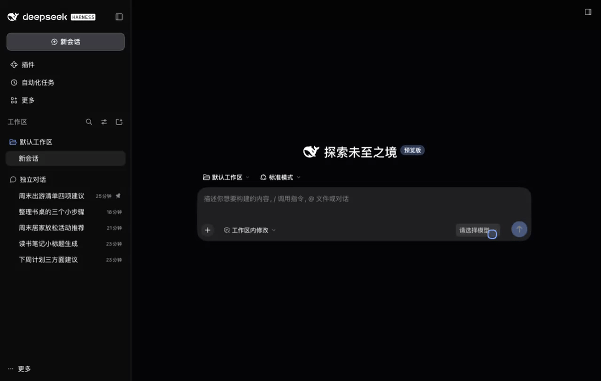
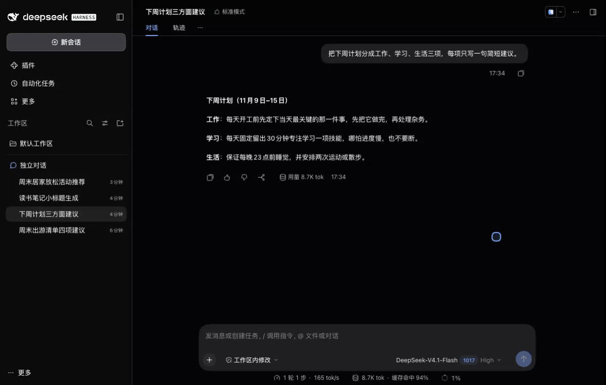
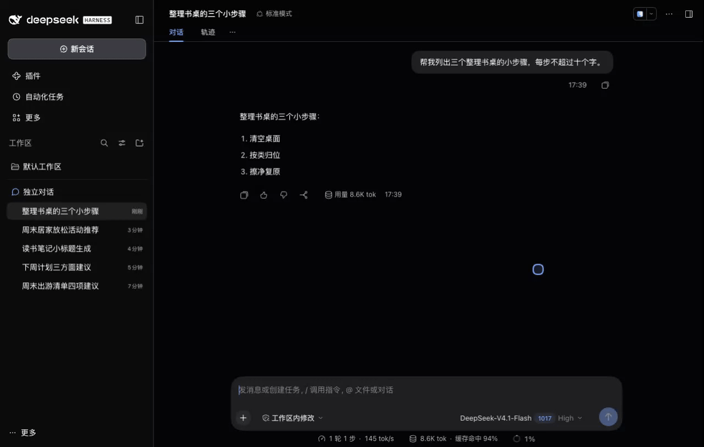
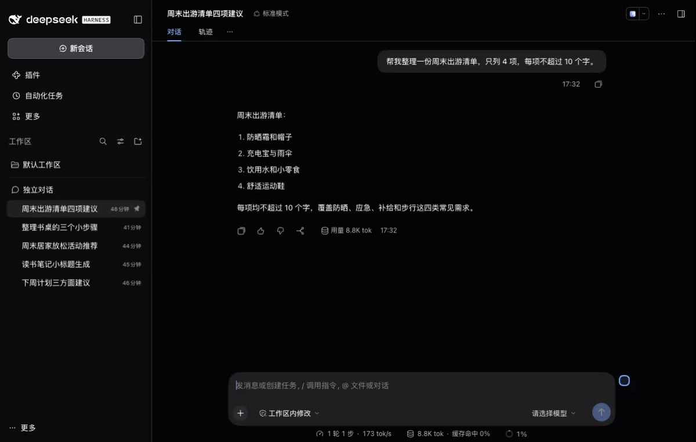

  

<h1 align="center">dsh-chat-sessions</h1>

  简体中文 · <a href="README.en.md">English</a>

  
  
  

  <a href="#功能">功能</a> · <a href="#安装">安装</a> · <a href="#注意事项">注意事项</a> · <a href="docs/CONFIGURATION.md">配置参考</a> · <a href="CHANGELOG.md">更新日志</a>

---

一个 [DeepSeek Harness](https://github.com/deepseek-ai/deepseek-harness) 插件：一键新建自带独立工作区的会话，让日常问答和小型任务无需手动选择项目目录即可开始，同时各个会话产生的文件不会相互影响。外观与交互贴近 DSH 原生侧栏，融入现有的会话操作习惯。

  

## 功能

| 功能 | 说明 |
| --- | --- |
| **一键开始，工作区独立** | 一键新建自带独立工作区的对话，各自存放任务产生的文件，不同任务互不混杂，无需先手动选择项目目录。 |
| **现有的会话操作习惯** | 交互方式与原版 DSH 保持一致，切换、置顶、归档与恢复等操作沿用熟悉的方式，上手无需重新适应。 |
| **文件管理，方便查找** | 按会话标题整理文件入口，方便找到某次对话中产生的文件，随时查看、编辑或继续使用。 |

### 功能演示

一键开始

  

会话管理

  

归档与恢复

  

## Requirements

宿主要求：DeepSeek Harness `>=0.2.0-rc.2 <0.3.0-0`，开发与测试基线为 `0.2.2-rc.1`。

## 安装

当前版本 **v0.1.1**：[GitHub Release](https://github.com/ZSQBFan/dsh-chat-sessions/releases/tag/v0.1.1)。

1. 从 Release 下载 `dsh-chat-sessions-0.1.1.tgz`（另附 SHA256 校验文件）。
2. 在 DSH「插件 → 添加插件」中填写下载文件的绝对路径，安装并启用；按宿主提示重新加载或重启。

`main` 分支用于后续开发，固定版本请使用对应 Release 的安装包。

## 注意事项

- **升级**：保留原有 `root` 配置。更改存放位置不会自动迁移旧数据；旧版已归档的会话可从原生归档列表手动恢复。
- **归档**：v0.1.1 的空白对话由用户手动归档，启动或重新启用插件时也会保留。归档和恢复使用原生会话菜单及归档列表；归档会取消置顶，恢复后可重新置顶。
- **目录保留**：插件不再回收任何房间目录，包括已归档的空目录。停用、卸载、重新启用、启动维护都不会移动、改名或删除房间目录里的内容；只有你自己在文件系统里删，目录才会消失。
- **工作目录**：房间位于 `<root>/.sessions/`，标题链接只是文件入口。新房间有独立工作区与目录，派生或后续会话可能共享该目录；独立目录不等于系统沙箱。
- **后台维护**：约每 15 秒同步标题链接和工作区归属。未发送草稿保存在浏览器中。
- **停用与重装**：通过 DSH 原生「插件」页面停用插件或停用整个 bundle 时，插件会把这些会话的**工作区登记**撤掉，会话回到原生的「未分组」，仍可直接继续聊天、在原目录里使用工具。会话 ID、历史、`cwd`、目录内容、标题软链接、归档与置顶状态都保持不变。重新安装或重新启用时，只把「仍然未分组、目录身份匹配、归属明确」的旧会话重新注册回原来的房间；停用期间你自己收编的会话保持新安排，不会被抢回来。
- **普通重启不会解绑**：进程重启、普通热更新、无关配置刷新都保留原来的工作区与房间，不会重建工作区。只有你在原生界面上**显式停用/卸载**才会交接；直接删掉插件包、强杀进程不承诺自动交接。
- **恢复冲突**：房间目录被删除或替换（`dev/ino` 变了、软链跑到 `root` 外）、房间里有无法确认归属的外来会话、账本被改坏时，插件采取保守策略——保留登记、把房间标成 `CONFLICT` 并在状态接口里给出原因，不猜、不删、不 `mkdir`。
- **离线限制**：交接与恢复需要宿主在运行（原生插件管理器的停用流程里宿主服务仍可用）。离线删包、无宿主时手改文件不在承诺范围内。
- **生命周期账本**：`<DSH_HOME>/storages/dsh-chat-sessions-lifecycle/<scopeId>/ledger.json`，按「DSH 数据根 + profile + 插件 + 房间根」划分 scope，只记录会话 ID、路径、阶段与错误码，不记录对话内容。损坏时插件进入只读降级（`DEGRADED`），不会继续改原生登记。
- **首次升级迁移**：从没有账本的旧版本升级上来时，插件按「原生登记 + 真实目录 + 会话 header」三份证据认领能确认的旧房间；证据不足（目录缺失、`cwd` 不符、会话日志缺失、目录身份变了）只计数、不猜、不动，并记下迁移完成标记，不会每次启动重扫。
- **卸载**：原生「移除插件」与「停用 bundle」在宿主里是同一条 dispose 路径（宿主要等插件交接完才去删包），所以账本里两者都记为 `BUNDLE_DISABLE`；能保证的是登记确实撤掉、目录与会话原样。
- **账本写入失败**：新建会话需要先落账本意图，写不进去时返回 `503 LIFECYCLE_LEDGER_UNAVAILABLE` 并进入只读降级，不会留下没有账本的空壳房间。

## 配置

默认配置即可使用。完整的配置项、默认值、取值范围及示例见[配置参考](docs/CONFIGURATION.md)，包括存放位置、侧栏分组、动效、视觉标记、工作区名称和实验选项。

旧版 `idleMs` 已停用，保留旧配置也不会生效。

## 更新日志

**v0.1.1** 修复空白对话等待约 90 秒后被自动归档、编辑器退回工作区选择的问题。

完整版本历史见[更新日志](CHANGELOG.md)。

## 开发检查

开发环境与检查命令

需要 Node 22 及以上；CI 使用 Node 22。`npm ci` 安装开发依赖后：

- `npm run check`：包结构、导出、patch 与语法检查。
- `npm test`：文件系统、DOM 与行为测试，只用开发依赖，不需要原生 DSH 包。
- `npm run test:native`：原生侧栏投影契约，需本机已安装 DSH，并用 `DSH_NATIVE_WORKSPACE_CLIENT` 指向它的 `@deepseek-ai/dsh-client-ui-workspace/lib/client.js`。
- `npm run test:lifecycle:native` / `npm run test:lifecycle:e2e`：隔离真实宿主的服务级生命周期测试；后者不含浏览器。

完整独立验收见[测试手册](docs/testing/20261108/TEST-PLAN.md)，交给另一会话可使用[DeepSeek V4.1 Flash 执行 prompt](docs/testing/20261108/AGENT-PROMPT.md)。

`check-*-browser.mjs` 是需要用浏览器手动打开的夹具，不包含在 `npm test` 内；其中成员位移夹具也需设置 `DSH_NATIVE_WORKSPACE_CLIENT`（或 `HARNESS_ROWS_SOURCE`）。CI 配置见 `.github/workflows/ci.yml`。

## 兼容与反馈

主要在 macOS 的 DSH 0.2.2-rc.1 环境使用和验证，其他平台与版本尚待验证。插件依赖原生侧栏结构，DSH 更新后可能需要适配。

这是个人维护项目，按实际使用情况更新。遇到问题请到 [Issues](https://github.com/ZSQBFan/dsh-chat-sessions/issues) 附上 DSH 版本、系统和复现步骤；截图或日志请先移除私人内容。

[MIT](LICENSE) · zsqbfan
