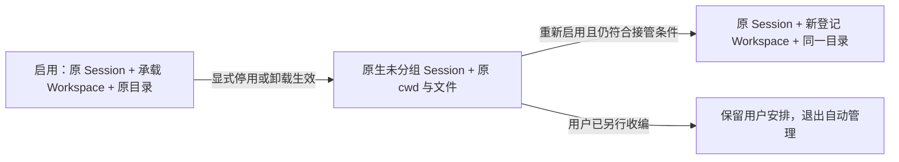

# dsh-chat-sessions 生命周期交接：详细设计

文档编号：LC-DESIGN-20261107；修订：1.0；日期：2026-11-07（UTC+8）。
状态：开发目标与验收合同，尚未实现或通过验收。配套：[验收规范](./02-ACCEPTANCE.md)、[开发 agent 执行 prompt](./03-AGENT-PROMPT.md)。

## 1. 目标与最终用户体验

插件启用时继续提供“独立对话”：用原生 Workspace 承载原生 Session，前端将承载工作区显示为独立会话簇。用户停用或卸载插件时，解除插件管理的 Workspace 登记，让旧会话归入 DSH 原生“未分组”；原任务目录、目录中的文件、标题软链接和会话历史保留原位。重新安装或启用时，只接管仍未分组且所有权明确的原插件会话，重新关联原目录。

这里的“无工作区”是没有 Workspace 登记认领会话；Session 日志头里的 cwd 仍指向旧目录。Session ID 与 cwd 不变；新注册的 Workspace ID 可以变化。

本合同替代 2026-11-04“停用后保留每个活跃普通工作区”的旧设想；也替代旧的已归档空任务目录自动回收行为。该功能范围内所有已管理任务目录均持久保留，包括空目录。目录回收若以后另做，应单独提出用户可见功能。



## 2. 范围与不变量

| 编号 | 必须实现的约束 |
|---|---|
| R01 | 在支持的原生管理器路径中，停用／卸载生效时交接自有登记，不要求用户先执行另一条迁移命令。 |
| R02 | 交接及重新接管不移动、改名、删除或改写已有任务目录与文件；已有软链接目标和名称保持；只写独立元数据账本。 |
| R03 | Session ID、持久日志头 cwd、历史日志内容保持；继续聊天产生的原生追加记录另行核对。 |
| R04 | 置顶顺序、归档状态与草稿不被交接主动清空、重排、发送或恢复；正常浏览器／宿主退出的草稿持久化能力单独标注。 |
| R05 | 按房间处理共享 cwd；同一房间多个 Session 至多关联一份承载登记。 |
| R06 | 普通进程重启、普通 HMR、非卸载配置刷新保持原 Workspace ID 和成员；明确的 root／模式变更按 R12 处理。 |
| R07 | 启用先恢复账本和交接状态，再开放新建、空白复用、sweep、标题维护和前端分类。 |
| R08 | 接管以账本身份、真实目录和当前归属共同判定；单独的路径前缀、标题、软链接或 .links.json 均不足以证明所有权。 |
| R09 | 停用期间用户已收编到其他工作区、已注册同路径普通工作区、改动目录或新增非管理成员时保留其安排，记录冲突／退出管理。 |
| R10 | 阶段落盘先于原生归属变更；崩溃后依据账本加当前原生状态幂等收敛。 |
| R11 | 冻结插件自身写入口并排空有限任务；旧异步结果不得在停用后补登记、改链接、回收目录或导航。 |
| R12 | profile、root、ownership 模式变化不隐式迁移目录、不跨 scope 接管；旧 root 可读账本保留，需明确冲突结果。 |
| R13 | 生产验收不手改原生日志、Workspace 存储或 profile 来“修正”结果；全部破坏性夹具仅在隔离实例。 |
| R14 | 现有普通工作区、非管理未分组会话、子代理会话不被批量认领或删除登记。 |
| R15 | 真实插件管理器、真实浏览器与原生存储语义均有证据；纯函数测试不替代生命周期实测。 |
| R16 | 元数据损坏／缺失／锁冲突时停止该 scope 的自动归属变更，保持任务数据，明确暴露状态。 |
| R17 | 已完成交接后停用、卸载、重装重复执行结果一致；不存在无成员的遗留承载壳。 |
| R18 | 普通原生未分组旧会话在目标宿主上可打开、继续聊天并在原 cwd 运行工具；宿主若不支持，则此产品目标未完成。 |

R01 是完整交付门槛。已停止进程后直接删包、杀进程等没有退出代码运行机会的路径属于离线异常情形，不承诺当时自动解除；其残留状态必须可诊断并在下次启用时保守恢复。不得将这种异常扩展成正常原生卸载也无需交接。

## 3. 代码基线与已知事实

本轮只读核对仓库 `/Users/qbfanzs/DSH_Common_Workplace/dsh-chat-sessions-dev`，版本 0.1.1，分支 main，HEAD `06d39d1a88e5833897d48606a1d3c2eff8dee0fe`，当时工作区干净。后续 agent 必须重读实际 HEAD；这些是证据基线，不是强制 reset 目标。

| 现有位置（相对仓库） | 已知职责／本次需处理之处 |
|---|---|
| `index.js:268 createStandaloneSession()` | mkdir→登记 Workspace→原生创建 Session→flush/stat；需要接入持久创建意图与管理账本。 |
| `index.js:316 reusableBlankSession()` | 用原生 blank、运行状态和 cwd 找空白；增加管理状态筛选，跳过冲突和交接中的会话。 |
| `index.js:357 reuseOrCreateBlank()` | 共享 Promise；要受生命周期入口闸门、generation 与账本串行机制控制。 |
| `index.js:394 ensureSessionWorkspace(sessionId,cwd,preserveMissing=false)` | 会 mkdir 与补登记；恢复旧房间时禁止无条件补目录／归属。 |
| `index.js:629 sweep(only,options={})` | 归属、标题、归档入口同步；必须从账本筛选托管房间。 |
| `index.js:734–784` | 启动空目录回收与 15 秒维护；取消本功能范围内任务目录回收，调整初始化顺序。 |
| `client.js` | 目录形状识别、压平、原生组件包装、5 秒刷新、动效；改为消费服务端管理状态，退出清理完整。 |
| `links.js` / `gc.js` | 软链接管理／旧空目录回收；生命周期阶段不触发改名、归档移动、删除任务目录。 |
| `package.json:5–9,40–52` | 现有 check、test、test:native；新增文件要进入测试命令及候选包 files。 |

已从当前桌面应用 ASAR 只读提取宿主证据，副本位于 `/Users/qbfanzs/.dsh/chats/.sessions/session-d99228ff-4e4d-4fc4-bfcc-cc288e8e11f9/lifecycle-host-evidence/`。可重读以下相对副本路径，不修改应用包：

- `@deepseek-ai/dsh-workspace/lib/index.js:111`：attachSession 校验日志头 cwd 与工作区规范路径；`:148` 的 detachSession 保留空壳。
- 同文件 `:408`：create 注册现存目录；`:469`、`:705–740`：delete 删除登记、保留目录、日志及全局归档／置顶集合。
- `@deepseek-ai/dsh-client-ui-workspace/lib/client.js:3699–3702`：未分组集合由所有会话减去 Workspace.sessionIds 认领集合得到；仍受原生 blank、归档和搜索过滤。
- `@deepseek-ai/cordis/src/fiber.ts:712–736`：异步清理可被等待，错误被记录；未发现明确 dispose reason 参数。
- `@deepseek-ai/dsh-plugin-manager/lib/index.js:2669,2688,2905,3129,3142–3212`：启停／移除会经过配置和 reload；changed 为操作后事件；无 HMR 的路径可能只在重启后生效。

这些事实只证明数据操作的基本语义，尚未证明“原生卸载能够可靠等待业务交接”、退出原因识别、原生未分组输入区能力以及跨原生操作的原子条件删除。

## 4. 开发前置门槛 G0：用真实宿主完成能力探针

先在隔离 profile 用最小插件和两个房间验证，不改业务源码来掩盖宿主限制。输出 `HOST-CAPABILITY.md`，至少包含：宿主准确版本、安装类型、插件管理方式、HMR 有无、事件顺序、清理依赖可用性、异步等待证据、失败表现、原生 UI 可用性。

探针必须回答：

1. 原生 plugin disable、bundle disable、bundle remove 分别如何触发？何时被视为“生效”？
2. 如何在清理前可靠区别 explicit-disable/remove 与 restart、普通 HMR、依赖重载？来源是公开上下文、正式 hook、配置的可靠状态，还是推测？
3. 先写入 PREPARE，故意阻塞清理至受控 barrier，再释放，管理器是否等待？失败是否可从账本／日志识别？
4. 若只收到 dispose，是否有经验证的后续收敛时点？普通重启不得偷偷采用“每次退出都解绑”的折中。
5. 未分组旧会话是否有原生输入区并能在原 cwd 执行文件工具？当前源码注释提示 composer 可能依赖工作区，此项必须真测。
6. 工作区创建复用同路径、删除、attach 的串行／版本条件是什么？如何避免检查后用户操作改变成员造成误删？

若插件公开扩展点不足，记录精确缺口及需要的宿主能力提案；继续完成可验证的状态机、文件保护与测试，但完整状态标为 `BLOCKED_HOST_CAPABILITY`。不修改 DSH 本体，不伪造 hook，不用 monkey patch 管理器或额外按钮代替 R01，也不声称全量交付。兼容版本只能依据真实探针列入。

## 5. 模块设计

以现有 ESM JavaScript、Node 内置模块和宿主服务为基础，避免整包技术栈重写。推荐拆分：

```text
index.js                         原生服务注入／现有 HTTP 的薄编排
lifecycle/store.js               scope、账本校验、原子持久化、锁
lifecycle/model.js               状态与决策纯函数、成员分类
lifecycle/coordinator.js         freeze/drain、detach、restore、generation
lifecycle/host-adapter.js        宿主能力、快照、条件操作和退出原因适配
lifecycle/legacy.js              一次性旧数据审计与迁移
client.js                       原生 UI 适配与服务端管理状态消费
check-lifecycle-*.mjs             状态机、持久性、故障与集成测试
```

允许合并文件保持项目轻量，但职责应可单测，禁止把所有阶段继续堆进 UI 扫描函数。建议内部接口（并非已经存在的 DSH API）：

```ts
type LifecycleReason = 'explicit-disable' | 'explicit-remove' | 'restart' | 'reload' | 'unknown';
readScope(): Promise<ScopeState>;
reconcileStartup(): Promise<ReconcileResult>;
prepareDetach(reason: LifecycleReason): Promise<HandoffResult>;
restoreEligibleRooms(): Promise<RestoreResult>;
runManagedOperation<T>(kind: string, fn: (generation: number) => Promise<T>): Promise<T>;
```

代码仍可使用 JSDoc；上面类型是设计签名，不要求引入 TypeScript。

## 6. 持久账本与 scope

建议存放于有效 DSH 数据目录下的独立区域：`<effectiveDSHHome>/storages/dsh-chat-sessions-lifecycle/<scopeId>/`。不放在 npm 包、node_modules、会话 cwd、候选包或工作树里。实际有效 DSHHome 和 profile 身份从宿主正式上下文取值，须验证安装、卸载、重装都保持该位置。

scope 身份包含：规范化 DSH 数据根、宿主稳定 profile ID、插件标识、canonical root。若缺少稳定 profile ID，要验证已有隔离机制，避免用当前浏览器端口、进程 PID、时间戳或插件版本充当身份。root 改变创建新 scope，不自动迁移旧目录。多个 profile 共用物理 root 时，要识别跨 scope 所有权冲突。

建议 `scope.json` 保存格式版本、scopeId、profileId、root 原始与 canonical 路径、创建来源、migration 完成标记、generation、revision、rooms 和未完成 creation intents；与 `last-handoff.json` 的职责可合并，避免多文件“事务”假设。

以下 JSON 为格式示意，非真实会话数据：

```json
{
  "schemaVersion": 1,
  "revision": 8,
  "scopeId": "SCOPE_ID",
  "identity": {"profileId": "PROFILE_ID", "canonicalRoot": "/fixture/chats"},
  "migration": {"version": 1, "completed": true},
  "generation": 4,
  "rooms": {
    "ROOM_ID": {
      "ownerSessionId": "session-OWNER",
      "cwd": "/fixture/chats/.sessions/session-OWNER",
      "canonicalCwd": "/fixture/chats/.sessions/session-OWNER",
      "directoryIdentity": {"dev": "DEVICE", "ino": "INODE"},
      "workspaceId": "WORKSPACE_ID",
      "state": "MANAGED",
      "sessionIds": ["session-OWNER", "session-CHILD"],
      "operation": null,
      "members": {},
      "lastError": null
    }
  },
  "creationIntents": {}
}
```

目录身份 dev/ino 为适配后的字符串；支持的目标文件系统须验证。真实路径一致但 inode 换成另一目录时也记冲突；不因相同字符串盲认领。对于不提供稳定文件身份的平台，在兼容矩阵注明验证方式及限制。

### 6.1 持久性与单写入者

- 同一 scope 只有一个 writer；插件内部串行队列加跨实例锁。PID 只是线索，锁含随机 owner token、进程身份／启动信息、lease 或可验证存活依据。
- 锁回收必须保守；失去锁立即停止新归属变更。正常卸载只释放本进程且 token 匹配的锁，不删除别人的锁。
- 写入使用同目录临时文件→完整写入与 fsync→原子 rename→目标平台允许时 fsync 父目录。临时文件命名含 token；不使用覆盖用户目录的递归清理。
- 校验 schema、路径、成员唯一性、scope 和 revision；未知新版本或坏 JSON 为 `LEDGER_INVALID`。保留原件，不以 `{}` 静默重置。
- 允许维护最近有效账本副本，但回退后仍先 reconcile 原生实际状态；备份不意味着获得新增所有权。
- 账本记 ID、路径、阶段和错误码，不存对话内容、提示词、token、草稿正文。

### 6.2 新建事务也要记账

现有 mkdir→Workspace→Session 中断可能留下半成品。新建前先落 `ALLOCATED` creation intent（requestId、已分配 sessionId/cwd）；目录、登记、Session 持久化各阶段记录进展；flush/stat 成功并确认成员后提升为 `MANAGED`。

失败保留任务目录；只在确认该创建意图生成、成员仍匹配且无外来成员时撤销半成品 Workspace 登记。下次启用按 intent 对账，不生成第二个同请求 Session。空白复用也须验证成员仍 MANAGED，不重复创建会话或意图。

## 7. 状态机与结果分类

进程状态：`STARTING → READY → QUIESCING → DISPOSED`；存在错误时可为 `DEGRADED`。只有 READY 接受正常插件写操作。已托管房间和出错房间分别报告，不以全局 ready 隐藏局部失败。

房间状态：

| 状态 | 含义／允许的下一步 |
|---|---|
| MANAGED | 当前由本 scope 管理，普通维护可访问；显式交接进入 DETACHING。 |
| DETACHING | 持久退出意图已写，正在验证／删除自有登记；重启先对账。 |
| DETACHED | 自有登记已移除且相关会话无自有归属；等待重新启用条件接管。 |
| RESTORING | 已写恢复意图；记录新登记和已 attach 成员，允许幂等继续。 |
| PARTIAL | 同房间部分成员已接管、其余跳过或冲突；只维护明确已接管子集。 |
| RELEASED | 用户已收编或明确退出管理；无后续自动认领。 |
| CONFLICT | 目录身份、混合成员或能力不满足；保持数据与当前归属，需可见原因。 |

错误码单独记录，不将 ERROR 当成丢失上一步的状态。例如在 DETACHING 保存 `REGISTRY_DELETE_FAILED`，在 RESTORING 保存 `ATTACH_FAILED`；重试时仍知道意图。

成员可标记 `eligible / attached / user-owned / missing-session / conflict`。若同房间某个旧成员已被用户移走，仅恢复剩余仍未分组的合格成员；若原 cwd 已被注册为用户工作区，则整个房间停止自动接管。部分退出的成员不因以后的常规 sweep 重新被拉回。

阶段必须带 operationId、generation、预期旧 workspaceId、成员集合摘要与进度；结果为 `completed / partial / conflict / failed / unsupported`。只有所有合格房间已处理且无应交接残留时才为 completed；没有房间的幂等请求也可 completed。

## 8. 所有权与旧版本迁移

### 8.1 管理资格

正向证据优先：新建 intent／历史账本明确创建者、scope 与 room；当前真实 cwd、Session header、登记路径和成员共同相符。派生会话仅当来自可验证的同房间原生成员关系／创建事件、cwd 相符且非 subagent 时纳入。

同 root 下用户自己创建的目录／会话、通过软链接伪装路径、同标题普通工作区、子代理均为负向夹具。`.links.json` 只是名称索引，不能当唯一授权账本。

### 8.2 首次升级

首次从 v0.1.1 升级没有账本。先只读生成 migration 审计：当前有效配置、原插件识别的 room、owner Session ID 与目录 basename 关系、持久 header cwd、真实路径边界、对应原生登记和所有成员、现存标题链接／名称索引的辅助一致性。

只把能由原插件已有规则与以上多项证据确认的旧房间写入账本。无登记或归属混杂的候选先 CONFLICT，不用启动 sweep 补齐后再说“已证明”。对规则仍有歧义的旧数据保守跳过并列报告；若核心旧数据普遍无法迁移，该项验收不通过，不能靠人工偷偷补写生产账本。

第一次迁移成功后持久化 `migration.completed`。以后账本丢失不等同“新安装”，不要重新扫 root 接管。安装／迁移完成标记应有独立可校验来源，避免无法区别首次与损坏时盲扫；具体采用宿主持久配置标记或独立 migration marker，必须纳入崩溃测试。若无法辨别，则进入只读审计模式，不能自动删除现有登记。

## 9. 停用／卸载算法

1. 原生桥提供经 G0 验证的显式停用／卸载原因及本次 operationId；unknown 只记录诊断，不猜测。
2. 写入全局 QUIESCING、停止定时器入口、递增 generation，HTTP 新写请求返回稳定错误；取消前端晚到导航。
3. 排空已接收的创建、账本写入、归属维护、标题维护队列。长时 Agent 回合不是插件队列，不强制停止其任务；如原生运行状态与解绑不兼容，交接记失败而非杀任务。
4. 对每个 MANAGED／可重试房间刷新原生快照，计算当前账本成员与登记成员；发现外来成员则整房间 CONFLICT，保留登记，防止一起移走用户会话。
5. 持久写 DETACHING 与删除前条件；只在持久成功后请求原生删除登记。
6. 在宿主可保证的条件边界内重新校验路径、登记 ID、成员版本／集合，再删除整份自有登记。此处不能仅用普通 JS mutex 冒充原生原子性，见第 12 节。
7. 复读原生快照确认旧登记已不存在、没有插件创建的空壳、成员未被插件重新认领；保存 DETACHED 和成功摘要。发现用户并发新归属则记录 user-owned，不再干预。
8. 批量处理中一个失败不吞掉结果；允许继续处理互不相关房间。保留逐房间错误和可重试阶段，最后释放本 writer 的资源。
9. disposer 只在交接和持久结果处理结束后 resolve；宿主仍可能把失败降级日志，因此不能宣称“throw 就能阻止卸载”。插件退出后报告依赖持久摘要和宿主日志，不依赖已消失的插件页面。

不逐个先 detach 再 delete，以免中间空壳；也不直接改原生 JSON。若宿主已自行删去登记且成员状态符合退出意图，按幂等成功处理；若 ID 被替换或成员变动，重新分类，不拿旧 ID 盲删。

## 10. 重新启用算法

1. 解析 scope，获得锁并验证账本。保持 STARTING，不开放复用、新建和旧 sweep。
2. 对 creation intent、DETACHING、RESTORING 作原生状态对账。退出未完成且插件现在已启用时，以 READY/MANAGED 为目标；仍有正确自有登记则保留，已删登记则按恢复资格接管。不为追赶旧退出意图先删再建。若明确停用仍待完成，则交接协调器维持相应目标。
3. 分类目录：存在、真实路径和身份匹配才可恢复；目录缺失／替换／symlink 越界记冲突，不 mkdir 原路径，不搜索用户其他目录找替代品。
4. 分类成员：日志仍在、cwd 匹配、非 subagent、未被任何 Workspace 认领才 eligible。已有用户归属的成员 RELEASED；缺失 Session 不补造日志。
5. 查询 canonical cwd 是否已有登记。已知是本次 RESTORING operation 创建的自有登记可继续；已有未能证明自有的同路径登记视为用户收编，整个房间跳过。不得仅因 create(path) 返回已有登记便宣称拥有它。
6. 有 eligible 成员时先落 RESTORING，注册已有目录，记录返回 ID 与创建来源；逐个 attach 前重新检查归属与 cwd，attach 后复读。没有 eligible 时不造空壳。
7. attach 中断保留进度；回滚仅清除本操作新建且依旧没有成员的登记，不动目录，不误删已有登记或已 attach 的会话。已 attach 子集保持并标 PARTIAL，后续只重试合格成员。
8. 持久写 MANAGED／PARTIAL／RELEASED／CONFLICT 后，将明确管理的房间集合发布给前端；再开放 READY 和维护任务。
9. 启用不自动导航到任一旧会话，不自动发送消息、不取消归档；用户主动打开后由原生导航处理。

## 11. 对正常功能的改动

- `ensureSessionWorkspace` 拆分“新建任务可 mkdir”与“恢复已有任务只校验”；所有旧 room 的补登记都经过 coordinator。
- `sweep` 不重新发现并接管任意 root 下的 Session，不触碰 DETACHED、RELEASED、CONFLICT 成员；只处理有资格的 MANAGED 子集。
- 停用／恢复事务冻结标题软链接和 .archive 移动，原有链接原位保留；恢复完成后正常用户改标题、归档触发的既有入口维护仍按产品语义运行，不冒充交接写入。
- 取消此 scope 的自动任务目录 GC。旧 `gc.js` 如保留兼容导出，生产调用链不得再删这些目录；更新旧测试期望，说明行为变化，不能保留一个隐蔽的 boot-only 回收入口。
- 前端状态依赖服务端 `managedWorkspaceIds / managedSessionIds` 或等价集合。receipt 形状只能作为展示辅助，不能把已 RELEASED 的普通工作区继续压平。
- 停用时清除插件 observer、slot、style、timer、动画和行标记，原生 WorkspaceBrowser 自行展示未分组，不克隆一份自定义未分组列表。
- `ownership:'bare'` 不因本功能自动转工作区；旧模式数据仅在兼容策略明确覆盖时迁移。`seedFirstTurn` 不用于伪造 Session 持久化。

## 12. 并发、代际与原生竞态

同一 scope 的插件创建、恢复、交接、sweep 串行；对每个异步边界复核 generation，旧 generation 的结果只允许完成其已经合法接受的持久步骤，不能发起下一步补登记或导航。dispose 要等待这些任务最终 settled，不以设置 disposed 布尔值代替 drain。

插件自己的队列无法锁住原生用户操作。必须区分：

- 能由自有队列保证的：重复点击、timer 与 detach、同进程反向启用。
- 必须由宿主操作语义保证的：校验成员后到 delete 之间，用户移入另一会话；查询未分组后到 attach 之间，用户另行收编。

G0 应寻找原生版本条件／事务／与登记内部队列同一临界区的合法接口。无原子条件接口时，应实际测试宿主是否阻止这些并发操作；不能以“删除前再读一次”声称消除竞态。若目标宿主仍可误移用户会话，记录 `HOST_ATOMIC_GUARD_MISSING`，R09／并发门槛不通过。可实现保守跳过和降低窗口，但报告其真实保证边界，不修改宿主私有对象绕过。

快速 disable→enable 必须等待旧 generation 完成或被判定中断并持久对账；新 writer 不与旧 writer 同时持锁。跨进程第二实例锁失败保持只读状态。

## 13. 故障恢复矩阵

| 中断点 | 下次启用的恢复依据与预期 |
|---|---|
| DETACHING 写盘前 | 原登记仍在，MANAGED；不假定执行过退出。 |
| DETACHING 已落盘、delete 前 | 复读自有登记，目标现为启用则保留并恢复 MANAGED。 |
| delete 成功、DETACHED 未落盘 | 账本意图加原登记缺失；按未分组恢复资格进入 RESTORING。 |
| RESTORING 已落盘、create 前 | 查询相同路径，区分用户登记与已确认自有中断结果。 |
| create 成功、ID 未落盘 | 需要 operation 关联证据／同一受控临界区；不能把任意同路径登记当作自己。来源不明 CONFLICT。 |
| 一部分 attach 成功 | 复读成员，确认本次操作归属，保留已成功部分并继续合格项。 |
| 原生变更成功、账本后写失败 | 保留前置意图与错误摘要；下一轮对账，禁止把失败当无变更而重复盲操作。 |
| 坏账本／未知 schema／scope 不符 | 保持目录和原生状态，DEGRADED 可见；不重建空账本。 |
| 目录已移动、删除或身份替换 | CONFLICT，不重建、不改写 header cwd。 |
| 锁被其他活进程持有 | 只读／失败报告；不抢锁、不双写。 |
| 进程被强杀或离线删包 | 当次没有自动交接保证；下次仅对已存在账本进行保守对账，明确残留。 |

创建返回与落盘之间的原子性不足时要保守处理，接受“有可诊断冲突，目录保留”，不允许为了恢复成功率扩大自动认领。

## 14. 诊断与接口契约

优先扩展既有 diagnostics/status，避免新增一套用户操作流程。内部字段名可调整，含义必须覆盖：schemaVersion、scopeId、generation、phase、capabilities、room/member 计数、上次 handoff operationId/reason/result、逐房间阶段和 reasonCode、账本位置与 revision、锁状态、pending operations、last error。

计数必须可对账：候选房间 = 成功 + 跳过 + 冲突 + 失败；逐成员归属列清楚。不要把 archived 或 blank 统计成丢失。

停用后插件接口可能消失，验收通过持久摘要和原生查询复核。CLI／测试读取摘要只读，不提供自动清理任务数据命令。非 READY 写请求建议返回 HTTP 409、稳定码 `LIFECYCLE_NOT_READY`；错误不是成功空列表。接口遵守现有本地访问和 body 限制，不扩大为远端迁移服务。

建议 reasonCode：`USER_CLAIMED`、`FOREIGN_MEMBERS`、`CWD_MISMATCH`、`DIRECTORY_MISSING`、`DIRECTORY_IDENTITY_CHANGED`、`SCOPE_MISMATCH`、`LEDGER_INVALID`、`LEDGER_WRITE_FAILED`、`LOCK_HELD`、`UNKNOWN_UNLOAD_REASON`、`REGISTRY_DELETE_FAILED`、`ATTACH_FAILED`、`HOST_ATOMIC_GUARD_MISSING`、`HOST_UI_UNSUPPORTED`。稳定的等价命名也可，需文档和测试统一。

## 15. Git、候选包与开发顺序

本文件交付不创建开发分支、不修改插件源码。执行配套 prompt 的 agent 必须：

1. 记录当前分支、完整 HEAD、工作区及未跟踪文件；尊重用户已有改动，不 stash/reset/clean。
2. 从当前确认的基线创建 `feat/lifecycle-ungrouped-handoff`；重名用 `-02` 等新名称，禁止强制重置既有分支。必要时用独立 worktree，保留原工作树。
3. 所有功能开发、测试与文档变更在新分支进行；本地按可审查单元提交，只暂存本任务明确文件。不推送、不合并、不打 tag、不正式发版。
4. 先 G0，再状态模型／store／旧迁移，再创建和恢复事务，再原生交接桥和 UI，最后全矩阵验收。若 G0 受阻也继续完成可独立验证部分，并明确整体仍受阻。
5. 新模块必须被 package files 收录；用 `npm pack --dry-run --json` 检查。候选 tgz 写到仓库外的验收 artifacts，记录 SHA256；真实隔离实例安装此 tgz，不用工作树假冒安装包。
6. 原有 `npm run check`、`npm test`、`npm run test:native` 均按真实条件执行；新增 lifecycle 测试要纳入默认测试，native skip 必须报告。
7. 同步中英文 README、配置说明和 CHANGELOG：说明保留目录、空目录 GC 行为变化、兼容宿主、离线限制和恢复冲突。不要扩大 engines 声明至未验证版本。

## 16. 完成条件

以配套验收规范为唯一正式判定。全部必测通过、真实原生停用与卸载证据齐全、无用户目录／会话内容损伤、分支提交和候选包可追溯，才能报告 COMPLETE。任何核心宿主能力、旧数据迁移、未分组继续工作或并发保护未证实，都应报告 PARTIAL／BLOCKED 并列出已经完成的部分。

报告应解释最终行为、变更原因、真实检查结果、剩余限制，不以“理论可行”“测试脚本存在”或大量通过计数替代核心结果。
